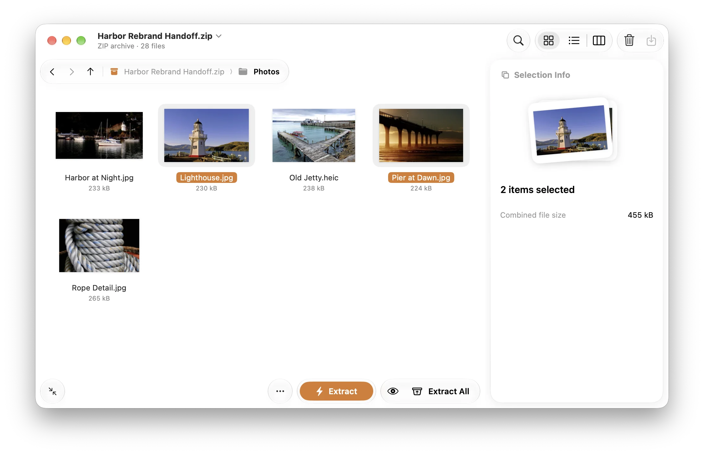

<p align="center">
  
</p>

<h1 align="center">Stow</h1>

<p align="center">
  A native macOS archive tool. See what’s inside, take the next step,<br>
  and pack files that open on anyone’s computer.
</p>

<p align="center">
  <a href="https://github.com/Beastry/stow/releases/latest"><b>Download</b></a> ·
  <a href="https://beastry.github.io/stow/">Website</a> ·
  <a href="ROADMAP.md">Roadmap</a> ·
  <a href="PARITY.md">Feature comparison</a> ·
  <a href="DEVELOPING.md">Build from source</a>
</p>

<p align="center">
  <picture>
    <source media="(prefers-color-scheme: dark)" srcset="website/assets/grid-dark.webp">
    
  </picture>
</p>

## Install

Download the signed, notarized DMG from the
[latest release](https://github.com/Beastry/stow/releases/latest) and drag Stow to Applications, or
use Homebrew:

```bash
brew install --cask beastry/tap/stow
```

Stow needs **macOS 26 or later** and runs on Apple silicon and Intel Macs. It updates itself
(Stow › Check for Updates…).

These are early releases. Staged editing and Extract and Repack are still marked 🧪 while they wait
for a full pass on real hardware; [ROADMAP.md](ROADMAP.md) lists what is left and which tests have
not been run yet.

## What Stow does

Most archive tools answer one question: where should this be extracted? Stow answers four.

| | |
| --- | --- |
| **What’s in it?** | Browse, search and preview everything, including archives inside archives, before anything touches your disk. Grid, list and column views; hover a file to peek. |
| **Anything to watch for?** | Checkup reads names, paths and apps as an archive opens and speaks up only when something needs a look. Entries that try to write outside the destination are kept inside it. |
| **What’s next?** | Actions offers the step that fits the selection: install a font or an app, open an installer, open a nested archive, or extract. |
| **Will it open for them?** | Say who the archive is for. Stow replaces names Windows rejects, leaves out Mac-only clutter, and shows every change before it packs. |

And around the Mac:

- **Glance**: a small window by the pointer for a quick look and a quick extract.
- **Tray**: a shelf in the menu bar. Gather files from anywhere, then pack them or drag them out together.
- **Quick Look**: press Space on an archive in Finder to see its contents without opening Stow.
- **Finder menu and Services**: Extract Here, Extract To…, Compress with Stow….
- **Editing** 🧪: add, rename, replace and delete inside ZIP, 7Z and TAR archives. Nothing is written until you save.
- **Encrypted and split archives**: open them, and create ZIP and 7Z with a password or in volumes.

## Formats

| Format | Extensions | Stow can |
| --- | --- | --- |
| ZIP | `.zip` `.zipx` `.jar` `.apk` | Open, edit, create (encryption, split volumes) |
| 7Z | `.7z` | Open, edit, create (encrypted file names) |
| TAR family | `.tar` `.tgz` `.tbz2` `.txz` `.tar.zst` | Open, edit, create (keeps permissions) |
| RAR 4 and 5 | `.rar` `.cbr` `.partN.rar` | Open and extract |
| Compressed files | `.gz` `.bz2` `.xz` `.lzma` `.lz` `.zst` | Open and extract |
| Disk images | `.dmg` `.iso` | Open and extract, without mounting |
| Packages | `.pkg` `.xar` `.cab` `.msi` `.rpm` `.deb` `.cpio` `.arj` `.lzh` | Open and extract |

Stow does not create RAR files; RAR creation is licensed by its authors.

## Your files stay yours

- **Everything happens on your Mac.** No accounts, no uploads, no analytics on what you open. The
  app has no network access of its own; only the updater fetches releases.
- **Parsing runs in isolation.** Archives are read by a separate sandboxed helper that receives an
  open file handle and nothing else, so a malformed file cannot reach the rest of the app.
- **Nothing changes until you save.** Extraction and edits are staged, checked and published in one
  step. Cancel, or hit an error, and the original is as it was.

Stow does not scan for malware. It checks code signatures and notarization before installing an
app, and macOS still checks that app the first time it opens. The details are in
[ARCHITECTURE.md](ARCHITECTURE.md).

## Build from source

You need macOS 26, Xcode 27 and [XcodeGen](https://github.com/yonaskolb/XcodeGen).

```bash
scripts/fetch-7zip.sh
xcodegen generate
xcodebuild -project Stow.xcodeproj -scheme Stow -derivedDataPath build build
open build/Build/Products/Debug/Stow.app
```

[DEVELOPING.md](DEVELOPING.md) covers tests, design-review screenshots, fixtures and the source
layout.

## Documentation

| Document | What it covers |
| --- | --- |
| [DEVELOPING.md](DEVELOPING.md) | Building, testing, screenshots, settings keys, source layout |
| [ARCHITECTURE.md](ARCHITECTURE.md) | The archive engine, Finder integration, the sandbox decisions, installing, updates |
| [DESIGN.md](DESIGN.md) | Design language: principles, vocabulary, colour, type, motion |
| [PARITY.md](PARITY.md) | Feature-by-feature comparison with ArcZip |
| [ROADMAP.md](ROADMAP.md) | Remaining work and tests not yet run |
| [ERROR-CODES.md](ERROR-CODES.md) | The error codes Stow shows |
| [RELEASING.md](RELEASING.md) | Signed and notarized builds, the Sparkle appcast, the release workflow |
| [AGENTS.md](AGENTS.md) | How the collaborators on this repository divide the work |

## Contributing

Bug reports, format requests, translations and pull requests are welcome in
[issues](https://github.com/Beastry/stow/issues). Archives that Stow struggles with are especially
useful; attach one if you can share it. Every user-facing string needs a Simplified Chinese
translation (`scripts/check-localizations.sh zh-Hans`).

## License

Stow is free software under the [GNU General Public License v3.0](LICENSE). Bundled third-party
components keep their own licenses; see [THIRD_PARTY_NOTICES.md](THIRD_PARTY_NOTICES.md). 7-Zip is
LGPL and ships as a separate executable with its complete modified source.

<p align="center">
  <sub>Stow is part of <a href="https://beastry.app">Beastry</a>, a family of friendly open-source tools.</sub>
</p>
